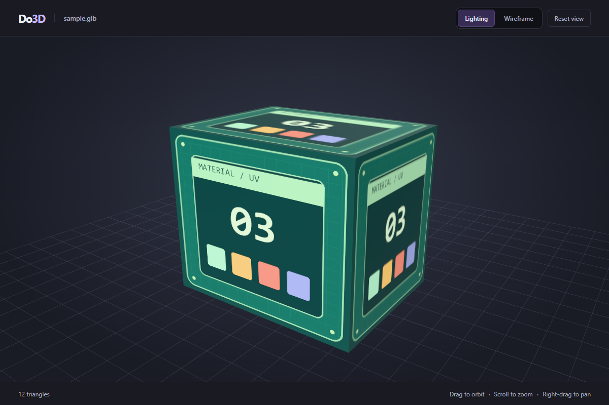

# Do3D

A Codex skill for turning an object description into a verified 3D asset in your project. Do3D researches the design, asks you to approve orthographic references, builds the model with PBR materials by default, and reimports the deliverable to check the result.



## Install the skill

Copy the entire [`do3/` directory](do3/) to your project's `.agents/skills/do3` or your personal `~/.agents/skills/do3`. Open Codex in the target project and select **Do3D** from the skill picker. In the CLI, type `$do3` to find it.

```text
$do3 Build a 240 × 75 × 25 mm matte plum pencil tray with a deeper well on the right. Deliver a low-poly GLB.
```

The skill follows the active project's asset conventions and includes project-specific instructions for TREDICI. It requires your approval of the reference images before modeling.

## Try the viewer

With Node.js 20+ and a WebGL 2 browser, run this command from the repository root.

```sh
node do3/viewer/launch.mjs do3/viewer/sample.glb
```

Pass your own GLB or glTF file path to preview it with the same viewer. Orbit, zoom, pan, and reset the camera. Switch between lit and unlit materials and toggle the wireframe independently. The viewer runs on loopback and bundles its dependencies for offline use.

## Documentation

- [Installation, invocation, and viewer options](do3/README.md)
- [Skill workflow](do3/SKILL.md)
- [TREDICI conventions](do3/references/tredici.md)
- [Three.js license](do3/viewer/vendor/LICENSE)
